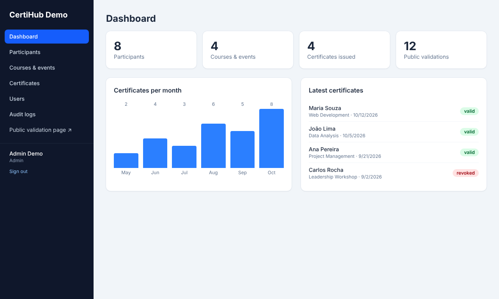
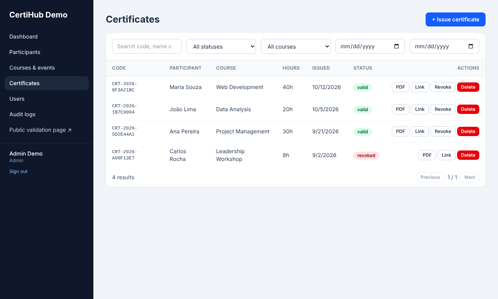
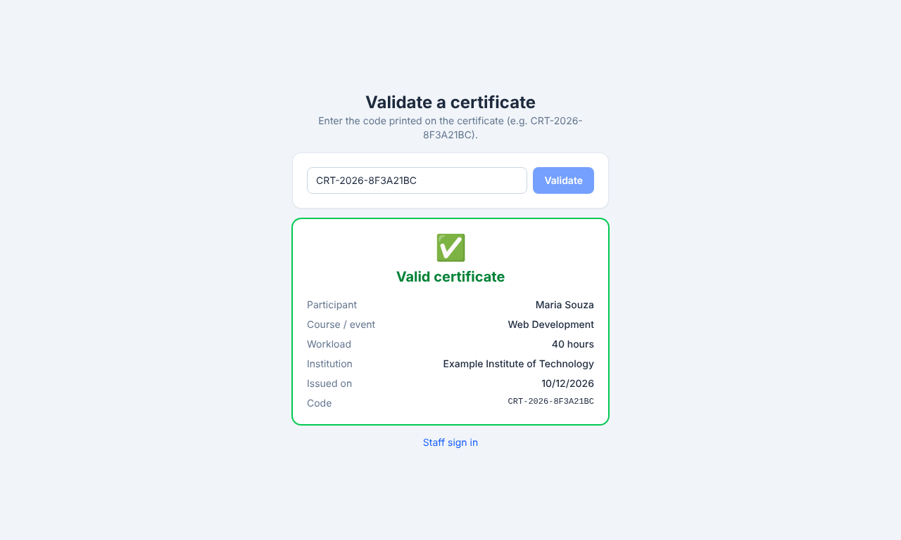
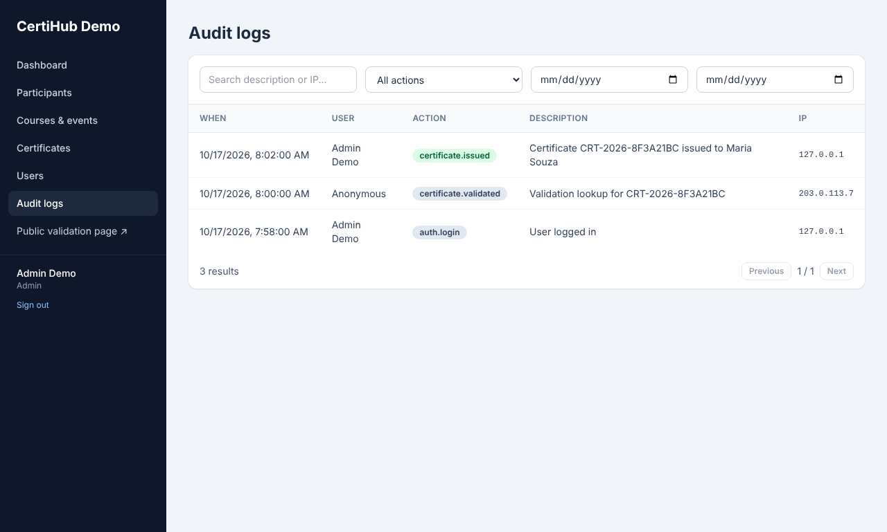
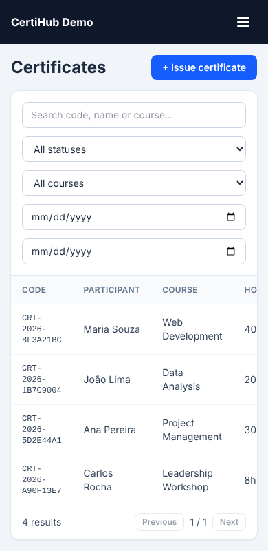

# CertiHub Demo

A demo web system to **register participants, issue PDF certificates and validate them publicly**.
Built as a portfolio project: a separate **Laravel API** and **Vue 3 SPA**, role-based access, audit logs and a public validation page.

> All data is fictional. The demo accounts use the password `password`; never deploy them as they are.



## Features

- **Access control:** login, logout, password recovery, token sessions with expiry, `admin` and `user` roles
- **Admin panel:** dashboard, participants, courses/events, certificate history with search and filters
- **Certificates:** PDF with a unique code (`CRT-2026-XXXXXXXX`), QR code, workload, date and institution data. Names and hours are copied at issuance, so later edits never change an issued certificate
- **Public validation:** `/validate/<code>` shows whether a certificate is valid, revoked or unknown, with basic data only
- **Audit log:** login, failed login, logout, user changes, issuance, downloads, revocations, deletions and public validations (user, date/time, IP, action)
- **Responsive UI** for desktop, tablet and phone

| Role | Can do |
|---|---|
| `user` | Create/edit participants and courses, issue and download certificates |
| `admin` | Everything above, plus deleting records, revoking certificates, managing users and reading the audit log |

## Stack

| Layer | Tech |
|---|---|
| API | PHP 8.3+, Laravel 13, Laravel Sanctum (bearer tokens) |
| Database | SQLite out of the box; PostgreSQL / MySQL work by changing `.env` |
| PDF / QR | barryvdh/laravel-dompdf, chillerlan/php-qrcode |
| Frontend | Vue 3, Vue Router, Axios, Vite, Tailwind CSS v4 |
| Tests | PHPUnit feature tests: authentication, permissions, issuance, PDF, public validation, audit log |

## Getting started

**Requirements:** PHP 8.3+ with the extensions `gd`, `mbstring`, `pdo_sqlite` (and `sqlite3`), Composer 2, Node 20+.
On Windows, enable them in `php.ini` (`extension=gd`, `extension=pdo_sqlite`, `extension=sqlite3`).

### 1. API

```bash
cd backend
composer install
cp .env.example .env          # on Windows PowerShell: copy .env.example .env
php artisan key:generate
php artisan migrate:fresh --seed   # accepts creating database/database.sqlite if asked
php artisan serve                  # http://localhost:8000
```

The API has no screens, so `http://localhost:8000` only returns a small JSON status.

### 2. Web app

In a second terminal:

```bash
cd frontend
cp .env.example .env          # on Windows PowerShell: copy .env.example .env
npm install
npm run dev                   # http://localhost:5173
```

Open <http://localhost:5173> and sign in:

| Account | E-mail | Password |
|---|---|---|
| Admin | `admin@example.com` | `password` |
| User | `user@example.com` | `password` |

The seeder creates 8 participants, 4 courses and 6 certificates (one of them revoked), so every screen has data.
Copy a certificate code from the list and paste it at <http://localhost:5173/validate> to try the public check.

### Tests

```bash
cd backend
php artisan test              # 14 feature tests, in-memory SQLite
```

### Using PostgreSQL instead of SQLite

Create an empty database and change these lines in `backend/.env`:

```
DB_CONNECTION=pgsql
DB_HOST=127.0.0.1
DB_PORT=5432
DB_DATABASE=certihub-demo
DB_USERNAME=postgres
DB_PASSWORD=your-password
```

Then run `php artisan migrate:fresh --seed`. Note that `migrate:fresh` drops every table in that database.

### Configuration

Besides the usual Laravel settings, `backend/.env` accepts:

| Variable | Default | Purpose |
|---|---|---|
| `FRONTEND_URL` | `http://localhost:5173` | Base URL used in password-reset links and QR validation links |
| `TOKEN_TTL_MINUTES` | `480` | Lifetime of a login token |
| `INSTITUTION_NAME` | Example Institute of Technology | Printed on the certificate |
| `INSTITUTION_SIGNATORY` / `INSTITUTION_SIGNATORY_ROLE` | Jane Doe / Academic Director | Signature block of the certificate |

**Password reset in development:** the mail driver is `log`, so the reset link is written to `backend/storage/logs/laravel.log`.

## Screenshots

| Certificates | Public validation |
|---|---|
|  |  |

| Audit log | Mobile |
|---|---|
|  |  |

More in [`docs/screenshots`](docs/screenshots) (login, participants, users).

## Project layout

```
backend/        Laravel 13 API (models, controllers, migrations, routes, PDF view, tests)
frontend/       Vue 3 SPA
docs/API.md     Endpoint reference
docs/screenshots/  Images of the real UI with fictional data
```

## API overview

All endpoints live under `/api` and use `Authorization: Bearer <token>`. The full list, with parameters and responses, is in [docs/API.md](docs/API.md).

| Area | Endpoints |
|---|---|
| Auth | `POST /auth/login`, `POST /auth/logout`, `GET /auth/me`, password recovery |
| Records | `participants`, `courses`, `certificates` (list, create, show, PDF; admin-only delete and revoke) |
| Admin | `users` CRUD, `logs` |
| Public | `GET /public/certificates/{code}` (rate-limited) |

## Deploying to a VPS (outline)

1. Nginx (or Apache) + PHP-FPM serving `backend/public`; the Vue build (`npm run build`) served as static files with a fallback to `index.html`.
2. In `backend/.env` set `APP_ENV=production`, `APP_DEBUG=false`, a real `APP_KEY`, database credentials, `FRONTEND_URL` and a real mail driver. Set `VITE_API_URL` before building the frontend.
3. `composer install --no-dev -o && php artisan migrate --force && php artisan config:cache && php artisan route:cache`.
4. HTTPS with Let's Encrypt, and create real users instead of running the demo seeder.

## Roadmap ideas

E-mail delivery of certificates (queues), digital signature, multiple certificate templates, CSV import of participants, reports, integrations through the API.

## About

Built by [Leonardo Fregnani](https://github.com/leofregnani) as a sample of a full-stack certificate management system. Available for freelance work on similar projects.
